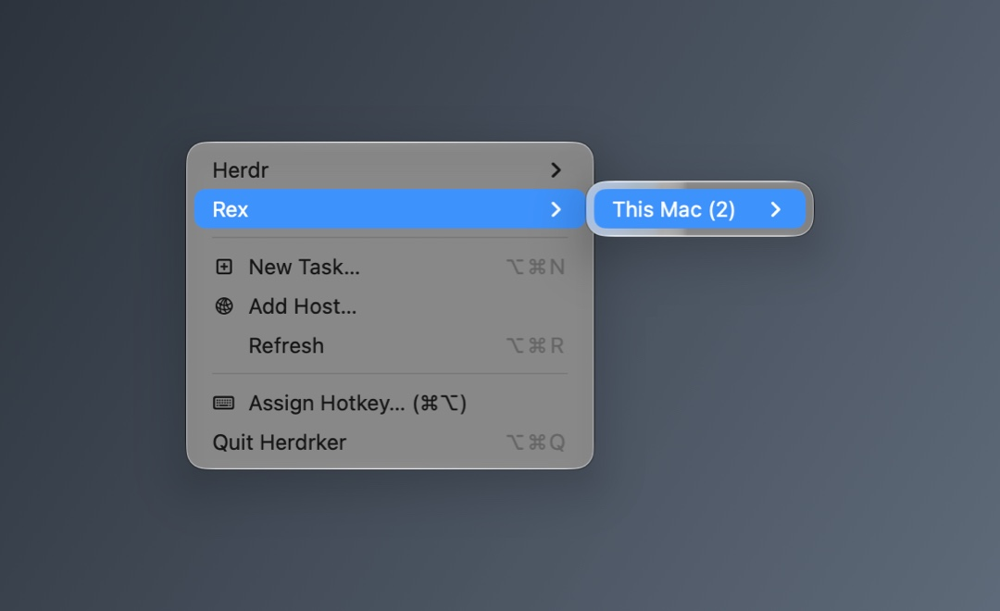
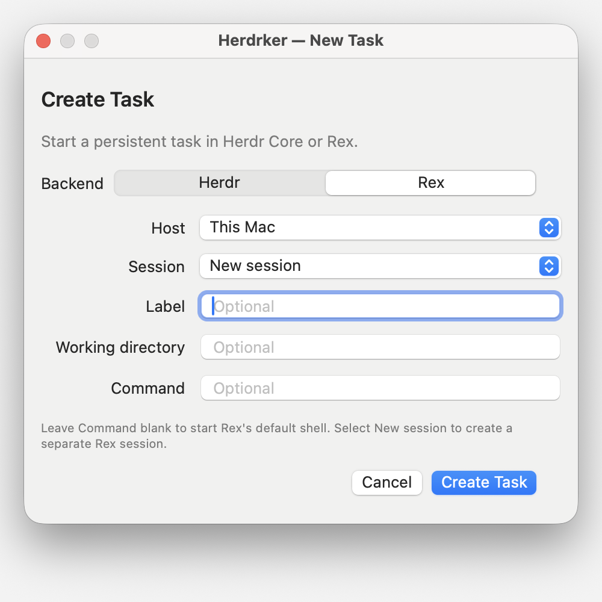

# Herdrker

> **Experimental prototype:** Herdrker is not a product. It is an experiment
> intended to explore what terminal backends such as `herdr-core` and Rex can do.

Herdrker is a macOS menu-bar controller for
[herdr-core](https://github.com/herdrdev/herdr-core) and Rex. It groups Herdr
tasks by host and Rex tasks by host, session, and window. Herdr live tasks open
in Ghostty or Terminal, and finished Herdr tasks remain available as read-only
final screens.

## Requirements

- macOS 14 or later
- `herdr-core` available as `herdr-core` or `hc`
- Rex is optional; its `rex` CLI enables the Rex backend
- Ghostty (optional; Terminal is the fallback)

## Usage

1. Launch Herdrker. It appears only in the macOS menu bar.
2. Choose **Add Host…** and register a remote machine with an installed
   backend. Herdrker remembers the last selected backend. Rex host registration
   does not install Rex Server automatically.
3. Choose **New Task…** and select an installed backend. Herdr supports parent
   tasks and space/tab locations. Rex supports hosts, sessions, windows, labels,
   commands, and working directories.
4. Open a Herdr task in Ghostty or Terminal, or open a Rex block in Rex. A red
   dot beside the menu-bar icon indicates that either backend has tasks.
   Backend sections with no tasks are hidden from the menu; New Task and Add
   Host still offer every installed backend.
5. Close the terminal window when you no longer need to see it. Closing the
   viewer does not stop the task; it continues under Herdr Core.
6. Reopen the task from its host submenu or with its global hotkey.





Finished tasks open as read-only final screens. Their submenu also provides
**Remove Task**; removal is available only for finished tasks and does not ask
for confirmation.

## Recommended Workflow

Create the persistent tasks needed for each host, then close their terminal
windows. Treat the windows as temporary views rather than as processes that
must remain open. Use hotkeys to switch to the task that needs attention and
close the window again when the work is no longer visible.

Tasks with a parent are nested below that parent in the host's menu. Parent
tasks still expose their own Attach/View action before their children.
Tasks placed in Herdr are grouped under their host as **Space → Tab → Task**;
tasks without a Herdr location remain directly under the host.
If two spaces or tabs share the same display name, short IDs are shown so they
can be told apart.

**Move to** appears only when the live task has another existing space or tab
available on its host. It lists the destination spaces and their tabs. Moving
keeps the task process running and places its existing terminal in the selected
Herdr tab. A live task without move targets remains directly selectable.

For example, keep a shell, build process, and agent session running on each
host. Close all three windows while working elsewhere. Use the host submenu or
a hotkey when one is needed; Herdrker focuses the existing tracked window or
opens a new viewer and attaches to the still-running task.

## Hotkeys

The menu assigns shortcuts to as many as 33 tasks across both backends using
the configured prefix plus `1` through `9`, `0`, then letters from `a` through
`z` except `n`, `r`, and `q`, which remain reserved for application actions.
The default prefix is `Command+Option`.
Use **Assign Hotkey…** to press a different modifier prefix, such as
`Command+Control` or `Command+Control+Option`; the new prefix applies to every
task shortcut. Keys already claimed by another application or macOS are omitted,
and the remaining shortcuts are assigned without gaps.

The same prefix applies to these application actions:

- `N`: New Task
- `R`: Refresh
- `Q`: Quit Herdrker

Hotkeys are global while Herdrker is running. Another application that uses the
same combination may lose that shortcut. During hotkey assignment, Herdrker
reports when one or more global shortcuts could not be registered.

## Relationship to tmux

Traditional tmux workflows place a multiplexer between the terminal and the
running program. Its prefix and copy mode can compete with the terminal's mouse
selection, while nested terminal and tmux scrollbacks can make it unclear which
buffer the mouse wheel is scrolling.

Herdrker does not add a copy-mode layer. Herdr Core owns task lifecycle and
scrollback, while Ghostty or Terminal provides the visible window and native
selection behavior. Closing or reopening a viewer does not restart the task.
Herdrker still respects mouse-reporting modes requested by full-screen programs.
All Ghostty task windows are created inside the existing Ghostty application
instance, so macOS shows one Ghostty icon in the Dock and application switcher.
Task-local environment markers are removed from new viewers so opening Herdrker
from inside a task cannot create a self-attach loop or join that task's cleanup
scope.

## Scrollback Behavior

Herdr Core keeps 5 MiB of scrollback per live terminal by default. Set
`history_mb` in `~/.config/herdr-core/config.toml` to change that byte budget;
new values apply to terminals created afterward. Herdrker restores all history
that Herdr Core has retained when attaching.

This is not a backup of an application's private scrollback. Full-screen
programs and some agent harnesses manage an alternate screen or their own
scrollback and may discard or rewrite earlier content themselves. Herdrker
does not merge or synthesize that hidden application-owned buffer. If a task
has already lost history, changing `history_mb` later cannot recover it.

## Build and Run

```sh
swift test
./scripts/build-app.sh
open build/Herdrker.app
```

Set `HERDRKER_CONFIGURATION=debug` for a faster local build. Distribution
builds must use a valid Developer ID Application identity. Set
`HERDRKER_SIGN_IDENTITY` to choose a specific signing certificate.

Creating a task automatically opens and attaches its terminal. The first 10
tasks in menu order are assigned shortcuts using the configured hotkey prefix.
